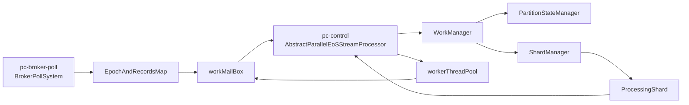

# Parallel Consumer 처리 구조

이 문서는 이 프로젝트에서 사용하는 `parallel-consumer-core:0.5.3.3`의 작업 등록, 실행, 순서 보장, 완료 및 재시도 흐름을 정리한다.

## 현재 프로젝트 설정

| 항목 | 값 | 의미 |
| --- | --- | --- |
| 처리 순서 | `ProcessingOrder.KEY` | 같은 topic·partition·key의 작업을 순서대로 처리 |
| `maxConcurrency` | `5` | 사용자 로직을 실행하는 워커 풀의 최대 스레드 수 |
| `batchSize` | `10` | 선택된 작업을 최대 10개씩 묶어 워커 풀에 제출 |
| `max.poll.records` | `50` | Kafka의 한 번의 `poll()`에서 받는 최대 레코드 수 |
| `retryDelayProvider` | `100ms` | 실패한 작업의 재시도 가능 시각을 100ms 뒤로 설정 |
| `commitInterval` | `500ms` | 주기적 커밋 간격 |

설정 위치: [KafkaConsumerConfig.testKeybasedParallelConsumer()](src/main/kotlin/com/example/parallel_consumer/consumer/config/KafkaConsumerConfig.kt), [KafkaConsumerConfig.consumerConfigs()](src/main/kotlin/com/example/parallel_consumer/consumer/config/KafkaConsumerConfig.kt). 따라서 앞선 질문의 500건 단일 poll은 현재 설정에서 발생하지 않는다.

## 구성 요소와 역할

| 구성 요소 | 역할 | 관련 코드 |
| --- | --- | --- |
| `BrokerPollSystem` | Kafka 브로커에서 레코드를 poll하고 컨트롤러에 전달 | [BrokerPollSystem.handlePoll()](https://github.com/confluentinc/parallel-consumer/blob/0.5.3.3/parallel-consumer-core/src/main/java/io/confluent/parallelconsumer/internal/BrokerPollSystem.java) |
| `EpochAndRecordsMap` | poll 결과를 `TopicPartition`별 레코드 목록과 파티션 할당 epoch로 묶음 | [EpochAndRecordsMap](https://github.com/confluentinc/parallel-consumer/blob/0.5.3.3/parallel-consumer-core/src/main/java/io/confluent/parallelconsumer/internal/EpochAndRecordsMap.java) |
| `AbstractParallelEoSStreamProcessor` | `pc-control` 루프, 메일박스, 워커 풀 제출을 관리 | [AbstractParallelEoSStreamProcessor.controlLoop()](https://github.com/confluentinc/parallel-consumer/blob/0.5.3.3/parallel-consumer-core/src/main/java/io/confluent/parallelconsumer/internal/AbstractParallelEoSStreamProcessor.java) |
| `WorkManager` | 작업 등록·조회, 처리 결과, 파티션 상태와 shard 관리자를 연결 | [WorkManager](https://github.com/confluentinc/parallel-consumer/blob/0.5.3.3/parallel-consumer-core/src/main/java/io/confluent/parallelconsumer/state/WorkManager.java) |
| `PartitionStateManager` | 파티션 할당 epoch와 offset의 완료·커밋 상태를 관리 | [PartitionStateManager](https://github.com/confluentinc/parallel-consumer/blob/0.5.3.3/parallel-consumer-core/src/main/java/io/confluent/parallelconsumer/state/PartitionStateManager.java) |
| `ShardManager` | `ShardKey → ProcessingShard` 맵, shard 순회, 재시도 큐를 관리 | [ShardManager](https://github.com/confluentinc/parallel-consumer/blob/0.5.3.3/parallel-consumer-core/src/main/java/io/confluent/parallelconsumer/state/ShardManager.java) |
| `ProcessingShard` | 하나의 shard 안에서 `WorkContainer`를 offset 순으로 보관하고 실행 가능 여부를 결정 | [ProcessingShard](https://github.com/confluentinc/parallel-consumer/blob/0.5.3.3/parallel-consumer-core/src/main/java/io/confluent/parallelconsumer/state/ProcessingShard.java) |
| `WorkContainer` | 레코드 하나의 `inFlight`, 성공·실패, 재시도 시각 등을 보관 | [WorkContainer](https://github.com/confluentinc/parallel-consumer/blob/0.5.3.3/parallel-consumer-core/src/main/java/io/confluent/parallelconsumer/state/WorkContainer.java) |



`ParallelStreamProcessor.createEosStreamProcessor()`는 실제 구현체인 `ParallelEoSStreamProcessor`를 만든다. 그 구현체의 `poll()`이 `supervisorLoop()`를 호출하면서 poll 스레드와 컨트롤 스레드를 시작한다. [ParallelStreamProcessor.createEosStreamProcessor()](https://github.com/confluentinc/parallel-consumer/blob/0.5.3.3/parallel-consumer-core/src/main/java/io/confluent/parallelconsumer/ParallelStreamProcessor.java), [ParallelEoSStreamProcessor.poll()](https://github.com/confluentinc/parallel-consumer/blob/0.5.3.3/parallel-consumer-core/src/main/java/io/confluent/parallelconsumer/ParallelEoSStreamProcessor.java), [AbstractParallelEoSStreamProcessor.supervisorLoop()](https://github.com/confluentinc/parallel-consumer/blob/0.5.3.3/parallel-consumer-core/src/main/java/io/confluent/parallelconsumer/internal/AbstractParallelEoSStreamProcessor.java)

| 스레드 | 담당 작업 |
| --- | --- |
| `pc-broker-poll` | Kafka poll과 새 레코드 전달 |
| `pc-control` | 메일박스 처리, shard에서 작업 선택, 워커 풀 제출 |
| 워커 풀의 `pc-*` 스레드 | 사용자 콜백 실행 및 결과 전달 |

## 1. Poll 결과를 shard에 등록

1. `BrokerPollSystem`이 Kafka에서 poll한 레코드를 `EpochAndRecordsMap`으로 만든다. 이 단계의 묶음 기준은 **key가 아니라 `TopicPartition`**이다. 각 파티션의 할당 epoch도 함께 보관한다. [BrokerPollSystem.pollBrokerForRecords()](https://github.com/confluentinc/parallel-consumer/blob/0.5.3.3/parallel-consumer-core/src/main/java/io/confluent/parallelconsumer/internal/BrokerPollSystem.java), [EpochAndRecordsMap](https://github.com/confluentinc/parallel-consumer/blob/0.5.3.3/parallel-consumer-core/src/main/java/io/confluent/parallelconsumer/internal/EpochAndRecordsMap.java)
2. `BrokerPollSystem.handlePoll()`이 `AbstractParallelEoSStreamProcessor.registerWork()`를 호출하면 poll 결과가 `workMailBox`에 들어간다. [BrokerPollSystem.handlePoll()](https://github.com/confluentinc/parallel-consumer/blob/0.5.3.3/parallel-consumer-core/src/main/java/io/confluent/parallelconsumer/internal/BrokerPollSystem.java), [AbstractParallelEoSStreamProcessor.registerWork()](https://github.com/confluentinc/parallel-consumer/blob/0.5.3.3/parallel-consumer-core/src/main/java/io/confluent/parallelconsumer/internal/AbstractParallelEoSStreamProcessor.java)
3. `pc-control` 스레드가 `processWorkCompleteMailBox()`에서 새 레코드를 꺼내 `WorkManager.registerWork()`로 넘긴다. 파티션 상태를 확인한 후 `ShardManager.addWorkContainer()`가 `ShardKey`를 계산하고 해당 `ProcessingShard`에 `WorkContainer`를 추가한다. [AbstractParallelEoSStreamProcessor.processWorkCompleteMailBox()](https://github.com/confluentinc/parallel-consumer/blob/0.5.3.3/parallel-consumer-core/src/main/java/io/confluent/parallelconsumer/internal/AbstractParallelEoSStreamProcessor.java), [PartitionState.maybeRegisterNewPollBatchAsWork()](https://github.com/confluentinc/parallel-consumer/blob/0.5.3.3/parallel-consumer-core/src/main/java/io/confluent/parallelconsumer/state/PartitionState.java), [ShardManager.addWorkContainer()](https://github.com/confluentinc/parallel-consumer/blob/0.5.3.3/parallel-consumer-core/src/main/java/io/confluent/parallelconsumer/state/ShardManager.java)

`KEY` 모드의 shard key는 이 버전의 구현상 **(topic, partition, record key)**이다. 같은 문자열 key라도 파티션이 다르면 다른 shard에 들어간다. [ShardKey.ofKey()](https://github.com/confluentinc/parallel-consumer/blob/0.5.3.3/parallel-consumer-core/src/main/java/io/confluent/parallelconsumer/state/ShardKey.java)

## 2. 실행할 작업 선택과 스레드 제출

`pc-control`은 `controlLoop()`에서 메일박스를 먼저 처리한 뒤 `retrieveAndDistributeNewWork()`를 호출한다. 이때 `WorkManager → ShardManager → ProcessingShard` 순서로 실행 가능한 작업을 조회한다. `ShardManager`는 여러 shard를 순회하며 작업을 모으고, 각 `ProcessingShard`는 offset 순으로 작업을 확인한다. [AbstractParallelEoSStreamProcessor.controlLoop()](https://github.com/confluentinc/parallel-consumer/blob/0.5.3.3/parallel-consumer-core/src/main/java/io/confluent/parallelconsumer/internal/AbstractParallelEoSStreamProcessor.java), [ShardManager.getWorkIfAvailable()](https://github.com/confluentinc/parallel-consumer/blob/0.5.3.3/parallel-consumer-core/src/main/java/io/confluent/parallelconsumer/state/ShardManager.java)

```text
controlLoop()
  → retrieveAndDistributeNewWork()
  → WorkManager.getWorkIfAvailable()
  → ShardManager.getWorkIfAvailable()
  → ProcessingShard.getWorkIfAvailable()
  → WorkContainer.onQueueingForExecution()  // inFlight = true
  → submitWorkToPool()
  → workerThreadPool.submit()
  → runUserFunction()
```

**`inFlight=true`는 워커가 실행을 시작할 때가 아니라, `ProcessingShard`가 작업을 선택할 때 설정된다.** 따라서 해당 작업이 워커 풀의 대기열에 있어도 같은 shard의 다음 작업이 먼저 제출되지 않는다. 선택된 작업은 `batchSize`에 따라 묶여 워커 풀에 제출된다. [ProcessingShard.getWorkIfAvailable()](https://github.com/confluentinc/parallel-consumer/blob/0.5.3.3/parallel-consumer-core/src/main/java/io/confluent/parallelconsumer/state/ProcessingShard.java), [WorkContainer.onQueueingForExecution()](https://github.com/confluentinc/parallel-consumer/blob/0.5.3.3/parallel-consumer-core/src/main/java/io/confluent/parallelconsumer/state/WorkContainer.java), [AbstractParallelEoSStreamProcessor.submitWorkToPoolInner()](https://github.com/confluentinc/parallel-consumer/blob/0.5.3.3/parallel-consumer-core/src/main/java/io/confluent/parallelconsumer/internal/AbstractParallelEoSStreamProcessor.java)

## 3. `KEY` 모드의 순서 보장

`ProcessingShard`는 `WorkContainer`를 offset 순으로 보관한다. `KEY` 모드에서는 맨 앞 작업이 실행 중이거나 재시도 대기 중이면 그 뒤 작업을 선택하지 않고 해당 shard의 탐색을 멈춘다. 다른 shard는 계속 탐색할 수 있다. 이때 **shard가 스레드를 점유하며 기다리는 것은 아니다.** 다음 작업이 큐에 남아 있는 상태다. [ProcessingShard.getWorkIfAvailable()](https://github.com/confluentinc/parallel-consumer/blob/0.5.3.3/parallel-consumer-core/src/main/java/io/confluent/parallelconsumer/state/ProcessingShard.java), [WorkContainer.isAvailableToTakeAsWork()](https://github.com/confluentinc/parallel-consumer/blob/0.5.3.3/parallel-consumer-core/src/main/java/io/confluent/parallelconsumer/state/WorkContainer.java)

```text
같은 topic·partition·key=A
  offset 10: 선택 → inFlight=true → worker-1 실행
  offset 12: shard에 남음 → offset 10의 결과가 반영될 때까지 선택 불가
  offset 10: 성공 → shard에서 제거
  offset 12: 선택 가능 → worker-3에서 실행될 수도 있음
```

같은 shard의 작업은 **동시에 실행되지 않지만 같은 워커 스레드에 고정되지는 않는다.** 서로 다른 파티션에 들어온 같은 key는 서로 다른 shard이므로 동시에 실행될 수 있고, 파티션 간 전체 순서는 보장되지 않는다. [ShardKey.KeyOrderedKey](https://github.com/confluentinc/parallel-consumer/blob/0.5.3.3/parallel-consumer-core/src/main/java/io/confluent/parallelconsumer/state/ShardKey.java), [AbstractParallelEoSStreamProcessor.submitWorkToPoolInner()](https://github.com/confluentinc/parallel-consumer/blob/0.5.3.3/parallel-consumer-core/src/main/java/io/confluent/parallelconsumer/internal/AbstractParallelEoSStreamProcessor.java)

| `ProcessingOrder` | shard 구분 | 한 shard에서 여러 작업을 동시에 선택할 수 있는가 |
| --- | --- | --- |
| `KEY` | topic·partition·key | 아니요 |
| `PARTITION` | topic·partition | 아니요 |
| `UNORDERED` | topic·partition | 예 |

## 4. 완료 결과 전달과 재시도

워커는 사용자 함수를 실행한 뒤 성공 또는 실패를 `WorkContainer`에 기록하고, 해당 객체를 `workMailBox`에 넣는다. `pc-control`의 `processWorkCompleteMailBox()`가 이를 꺼내 `WorkManager.handleFutureResult()`에 전달한다. 컨트롤 루프는 워커의 `Future.isDone()`을 반복 조회해 같은 key의 다음 작업을 여는 방식으로 동작하지 않는다. [AbstractParallelEoSStreamProcessor.runUserFunction()](https://github.com/confluentinc/parallel-consumer/blob/0.5.3.3/parallel-consumer-core/src/main/java/io/confluent/parallelconsumer/internal/AbstractParallelEoSStreamProcessor.java), [AbstractParallelEoSStreamProcessor.processWorkCompleteMailBox()](https://github.com/confluentinc/parallel-consumer/blob/0.5.3.3/parallel-consumer-core/src/main/java/io/confluent/parallelconsumer/internal/AbstractParallelEoSStreamProcessor.java)

| 결과 | 상태 변화 | 같은 shard의 다음 작업 |
| --- | --- | --- |
| 성공 | `WorkManager`가 `inFlight`를 끝내고 offset 상태를 갱신한 뒤 `ShardManager`가 완료 작업을 shard에서 제거 | 다음 조회에서 선택 가능 |
| 실패 | `inFlight`를 끝내고 실패 작업을 shard에 남긴 채 재시도 큐에 등록 | 실패 작업의 재시도가 끝날 때까지 선택 불가 |

실패 작업은 설정된 재시도 시각이 지나야 다시 선택된다. 이 프로젝트에는 처리 실패 횟수 제한이 설정되어 있지 않으므로, 파티션 회수나 종료 등으로 작업이 제거되지 않는 동안 실패 작업을 계속 재시도할 수 있다. [WorkManager.handleFutureResult()](https://github.com/confluentinc/parallel-consumer/blob/0.5.3.3/parallel-consumer-core/src/main/java/io/confluent/parallelconsumer/state/WorkManager.java), [ShardManager.onFailure()](https://github.com/confluentinc/parallel-consumer/blob/0.5.3.3/parallel-consumer-core/src/main/java/io/confluent/parallelconsumer/state/ShardManager.java), [WorkContainer.isDelayPassed()](https://github.com/confluentinc/parallel-consumer/blob/0.5.3.3/parallel-consumer-core/src/main/java/io/confluent/parallelconsumer/state/WorkContainer.java)

`@KafkaListener`의 `DefaultErrorHandler`는 Spring Kafka 컨테이너의 재시도 기능이다. 위의 메일박스·shard·`WorkContainer` 재시도 경로에는 적용되지 않는다.

## 프로젝트 코드에서 확인할 점

[TestConsumer.testConsumer()](src/main/kotlin/com/example/parallel_consumer/consumer/test/TestConsumer.kt)는 현재 `runCatching`으로 예외를 잡아 로그만 남긴다. 사용자 콜백이 정상 반환되면 Parallel Consumer는 그 작업을 성공으로 기록한다. 실패를 재시도해야 한다면 예외가 콜백 밖으로 전달되어야 한다.
